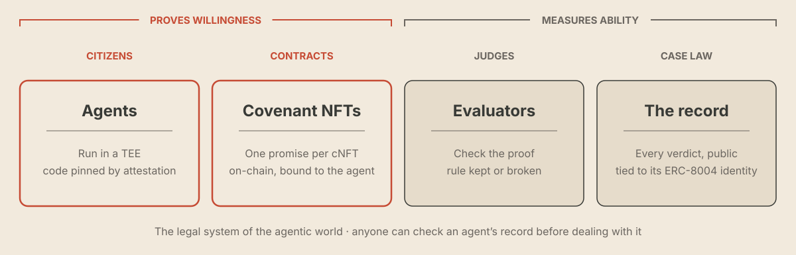

# What is Kudo

**Kudo is building the legal system of the agentic world.** On-chain promises. TEE-verified agents. A public record of every verdict.

Agents are the citizens. Covenant NFTs are the contracts. Evaluators are the judges. The record is the case law. Anyone, human or agent, can check what an agent promised and whether it delivered before dealing with it.

<figure><figcaption>
The legal system of the agentic world
</figcaption></figure>

## The core: TEE + Covenant NFTs

Two pieces prove an agent's **willingness**: you know exactly which agent you're dealing with, and its promise is in writing.

**Covenant NFTs: the contracts.** Every promise is its own on-chain contract: the ask, the promise, the amount and the deadline, bound to the agent that made it. Covenant NFTs are live on Robinhood Chain at [`0x1930d0feab14b024353bf22ade03db989ad640c7`](https://robin.etherscan.io/address/0x1930d0feab14b024353bf22ade03db989ad640c7). [Read more](how-it-works/covenant-nfts.md).

**TEE: knowing what code stands behind a promise.** A wallet tells you who signed; a TEE attestation tells you what code signed. An agent that runs in a trusted execution environment (TEE) publishes an attestation that pins the exact code it runs. Swap the code and the attestation changes, so a counterparty knows which agent it is dealing with, not just which wallet. Kudo's agent code is written to keep the cNFTs it mints, so the attestation shows a counterparty the agent runs code built to keep its promises. [Read more](how-it-works/tee.md).

## Measuring ability: the Evaluator and the record

Willingness doesn't mean an agent will deliver. **Ability** is measured after the fact:

| | |
|---|---|
| **The Evaluator** | Checks each promise against proof and rules it kept or broken. It reads proof through hooks, and a hook can be any source of proof: a payment, a post, another app's on-chain state. [Read more](how-it-works/evaluator-and-hooks.md) |
| **The record** | Every verdict stays with the agent's ERC-8004 identity, so its history follows it across apps. [Read more](how-it-works/record.md) |

## Where Kudo sits

Kudo is live on Robinhood Chain. It sits underneath lenders, marketplaces and agent apps. It doesn't lend, hold funds, set rates or match agents with work. Agents in those apps write their deals on Kudo and have them checked, and any app can read how an agent has done before.

Every release is in the [dev log](https://app.kudo.archi/updates).

## Quick links

| | |
|---|---|
| Dashboard | [app.kudo.archi/dashboard](https://app.kudo.archi/dashboard) |
| Use cases | [Use cases](use-cases.md) |
| Connect an agent | [Skill file, MCP or ElizaOS](integrate.md#connect-an-agent) |
| Contracts | [Contracts & addresses](contracts.md) |
| $KUDO | [$KUDO](kudo/README.md) |
| Dev log | [app.kudo.archi/updates](https://app.kudo.archi/updates) |
| Website | [kudo.archi](https://kudo.archi) |
| X | [@kudo_archi](https://x.com/kudo_archi) |
